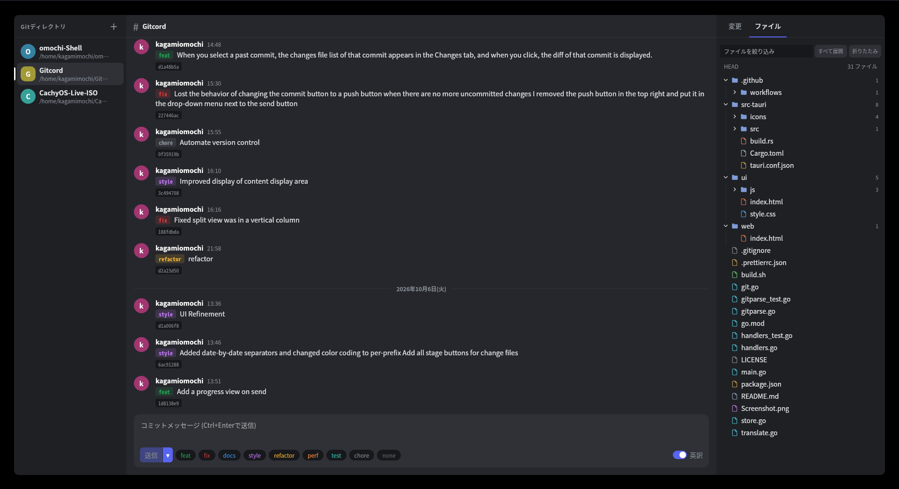

# Gitcord

DiscordライクなチャットUIで操作するGitクライアントです。

Gitディレクトリを左のDM欄に並べ、コミット履歴をチャットのように読み、メッセージ送信欄からコミットできます。



## 特徴

- **チャット風の履歴表示**: 下が新しく、上に行くほど古いコミット。スクロールで最初のコミットまで遡れます
- **未プッシュの強調**: まだpushしていないコミットは色を変えて表示
- **履歴の編集**: コミットを右クリックして操作できます
  - メッセージの編集(本文も含む。古いコミットも可)
  - 1つ前のコミットにまとめる(fixup)
  - 履歴から削除(drop)
  - 打ち消しコミットの作成(`revert`)、またはステージだけする(`revert --no-commit`)。マージコミットにも使えます
  - そのコミットまで戻す(`reset` の soft / mixed / hard)
  - ハッシュ・メッセージのコピー
  - コンフリクトなどで失敗した場合は自動で中断し、元の状態に戻します
  - push済みのコミットも書き換えられます(確認ダイアログあり)。反映は、送信ボタン横の「▾」から `force push (--force-with-lease)` で行います
- **操作履歴から元に戻す**: ヘッダーの「操作履歴」から、HEADが動いた履歴(reflog)を見て、任意の時点に戻せます。`reset --hard` や書き換えを間違えたときの保険です(未コミットの変更は保持されます)
- **コミット時点の閲覧**: コミットをクリックすると、その時点のファイル構造が見られ、ファイルをクリックするとその時点のファイル内容を表示
- **ダブルクリックで開く**: ファイル一覧(ファイル構造・変更ファイル)のファイルをダブルクリックすると、OSの既定のアプリで開きます(`xdg-open`)。コミット未選択の状態では作業ツリーのファイルを直接開き、過去のコミットを選んでいるときは、その時点の内容を読み取り専用のコピーとして一時フォルダに書き出して開きます
- **変更ファイルのdiff**: 「変更」タブでファイルをクリックすると、そのファイルのdiffを表示
- **ステージ操作**: 未コミットの変更を一覧し、チェックボックスでステージを切り替え
- **プレフィックス付きコミット**: `feat` `fix` `docs` `style` `refactor` `perf` `test` `chore` のボタンをワンクリックで付与。プレフィックスなしの場合も `none` を押す必要があり、押し忘れによるコミットを防ぎます。プレフィックスは設定画面から追加・削除・改名・色変更・並べ替えができます
- **コミットメッセージの自動英訳**: ON/OFFを切り替え可能(デフォルトON)
- **Gitディレクトリの追加**: アプリ内のファイルマネージャーで選択(Gitディレクトリにはバッジ表示)、またはcloneして追加(clone先とディレクトリ名を指定)
- **認証は既存の設定をそのまま利用**: 内部で `git` コマンドを呼ぶだけなので、credential helperやSSH鍵の設定がそのまま使えます

## インストール

対応OSは現在Linuxのみです。[Releases](../../releases) から、ディストリビューションに合ったファイルをダウンロードしてください。

| 形式 | 主な対象 |
| --- | --- |
| `.AppImage` | ほとんどのディストリビューション |
| `.deb` | Debian / Ubuntu系 |
| `.rpm` | Fedora / openSUSE系 |

AppImageは実行権限を付けて起動します。

```
chmod +x Gitcord_*.AppImage
./Gitcord_*.AppImage
```

実行には `git` がインストールされている必要があります。

## 使い方

1. 左上の「＋」からGitディレクトリを追加します。既存のディレクトリを選ぶか、URLを指定してcloneします。
2. 左の一覧からディレクトリを選ぶと、中央にコミット履歴が表示されます。
3. 右の「変更」タブで、コミットしたいファイルにチェックを入れてステージします。ファイル名をクリックするとdiffが開きます。
4. 下の入力欄にメッセージを書き、プレフィックス(または `none`)を選んで「送信」を押します。コミットに続けてpushまで自動で行われます。
5. コミットだけしたい場合は、「送信」の隣の「▾」から「コミットのみ」を選びます。この場合pushはされません。
6. コミットせずにpushだけしたい場合は、「送信」の隣の「▾」から「pushのみ」を選びます。

ファイルをダブルクリックすると既定のアプリで開けます。過去のコミットを選択中は、その時点の内容の読み取り専用コピーが開きます(編集してもリポジトリには反映されません)。

送信キーは左下の「設定」から Ctrl+Enter(既定) / Shift+Enter / Enterのみ のいずれかに変更できます(Enterのみの場合、改行は Shift+Enter)。キーで送信した場合もコミット→pushが行われます。設定はブラウザ(WebView)のlocalStorageに保存されます。pushに失敗した場合もコミット自体は完了しており、エラー内容がトーストで表示されます。

## 注意事項

- **英訳機能とプライバシー**: コミットメッセージの文面を翻訳サービス(MyMemory または DeepL)に送信します。機密性の高い内容を扱う場合は、英訳をOFFにしてください。OFFにすると、ネットワークには何も送りません。
  - 翻訳エンジンは左下の「設定」の「英訳」で選べます。「自動」(既定)は DeepL のAPIキーがあれば DeepL、なければ MyMemory を使います。
  - DeepL APIキー: 設定画面に入力します。末尾が `:fx` のキーは無料版、それ以外は有料版のエンドポイントに接続します。「接続テスト」でキーの動作を確認できます。
  - MyMemory 連絡用メールアドレス: 設定画面に入力すると、無料枠が 5,000 文字/日から 50,000 文字/日に増えます。
  - 設定画面が未入力の項目は、環境変数 `GITCORD_DEEPL_KEY` / `GITCORD_MYMEMORY_EMAIL` が使われます。
  - 設定画面の値はブラウザ(WebView)のlocalStorageに平文で保存されます。共有PCではご注意ください。
  - 英訳に失敗した場合は、原文のままコミットするか確認ダイアログが表示されます。
- **データの保存場所**: 追加したディレクトリの一覧は `~/.config/gitcord/repos.json` に保存されます。
- **ローカル通信のみ**: 内部のサーバーは `127.0.0.1` でのみ待ち受け、外部からは接続できません。

## トラブルシューティング

### Waylandで起動しない(`Error 71 (Protocol error) dispatching to Wayland display`)

WebKitGTKとの相性問題で、NVIDIA環境などで起きることがあります。次の環境変数を付けて起動してみてください。

```
GDK_BACKEND=x11 ./Gitcord_*.AppImage
```

AppImageで解決しない場合は、お使いのディストリビューションで [ソースからビルド](#ソースからビルド) すると、システムのWebKitGTKが使われるため安定することがあります。

## 既知の制限

- Linuxのみ対応です(Windows・macOSは未対応)
- 履歴は直近5000件までを一括で読み込みます
- 履歴の書き換え(メッセージ編集・fixup・drop)は、直線的な履歴にのみ対応しています。対象より後ろにマージコミットがある場合や、マージコミット自体には使えません
- 複数コミットの並べ替えや、複数選択でのまとめ(squash)は未対応です
- cloneの進捗は表示されません

## ソースからビルド

必要なもの: Go 1.22以上、Rust(stable)、Node.js、[Tauriの依存ライブラリ](https://v2.tauri.app/start/prerequisites/#linux)

```
TRIPLE=$(rustc -vV | sed -n 's/host: //p')
mkdir -p src-tauri/binaries
CGO_ENABLED=0 go build -ldflags="-s -w" -o src-tauri/binaries/gitcord-server-$TRIPLE .
npm install
npx tauri build --no-bundle
./src-tauri/target/release/gitcord
```

Tauriなしでバックエンドだけを動かして、ブラウザで試すこともできます。`http://127.0.0.1:8484`

```
go build -o gitcord .
./gitcord
```

### 構成

```
main.go          エントリポイント(フラグ解析、サーバー起動、UIの埋め込み)
handlers.go      HTTP APIのルーティングとハンドラー
history.go       履歴の書き換え(reword / drop / fixup / revert)とreflog。gitのrebaseエディタとして自分自身を呼び出す
git.go           gitコマンドの実行
gitparse.go      gitの出力(log / status / name-status)のパーサー
store.go         追加したディレクトリ一覧の保存(~/.config/gitcord/repos.json)
translate.go     コミットメッセージの英訳(DeepL / MyMemory)、エンジン選択
*_test.go        Goのテスト(`go test ./...`)
ui/              UI本体(Goバイナリに埋め込み)
  index.html       マークアップ
  style.css        スタイル
  js/util.js       共通ヘルパー、アイコン、API呼び出し、トースト
  js/diff.js       diffのパースと描画(統合表示 / 分割表示)
  js/app.js        画面ロジック(履歴、変更、ファイル、コミット、追加ダイアログ)
src-tauri/       Tauriのラッパー(Goバックエンドをsidecarとして起動し、ウィンドウで開く)
web/             Tauriの設定上必要な起動中スプラッシュ
```

UIを変更するなら `ui/`、Git操作やAPIを変更するなら `handlers.go` / `git.go` を編集します。
